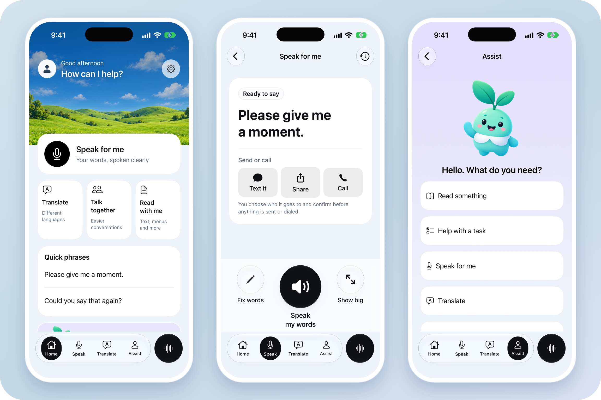

<p align="center">
  
</p>

<p align="center">
  <strong>A little more room to communicate.</strong><br>
  Speak your words. Translate a conversation. Read at your own pace.
</p>

<p align="center">
  <a href="https://sandeepshenoy.dev/bridge/"><strong>Website</strong></a> &nbsp;·&nbsp;
  <a href="https://sandeepshenoy.dev/bridge/install/"><strong>Install</strong></a> &nbsp;·&nbsp;
  <a href="https://sandeepshenoy.dev/bridge/features/">Features</a> &nbsp;·&nbsp;
  <a href="https://sandeepshenoy.dev/bridge/build/">Build from source</a> &nbsp;·&nbsp;
  <a href="https://sandeepshenoy.dev/bridge/privacy/">Privacy</a>
</p>

<p align="center">
  
</p>

Bridge brings speaking, translation, and reading support into one app, with time to review your words before you use them. Built by **Rhythmay Girdhar and Sandeep Shenoy** at Rouse High School, inspired by our grandparents.

Native iOS 18+ and Android 12+ apps, built with SwiftUI and Jetpack Compose. No account, no ads, and no Bridge server.

## Get Bridge

Download `Bridge.ipa` or `Bridge-android.apk` from **[Releases](https://github.com/sandeepwastaken/bridge-app/releases/latest)**. Step-by-step instructions are on the **[install page](https://sandeepshenoy.dev/bridge/install/)**.

## Repository

| Directory | Application | Stack |
| :--- | :--- | :--- |
| [`BridgeApp/`](BridgeApp/) | iPhone | SwiftUI, Apple speech and translation services |
| [`android/`](android/) | Android | Kotlin, Jetpack Compose, device speech and translation services |
| [`preview/`](preview/) | Browser preview | JavaScript, optional local Python model service |

Quick start for the browser preview (Node.js 22+):

```sh
node preview/server.cjs
```

Full iPhone, Android, and model instructions: **[Build from source](https://sandeepshenoy.dev/bridge/build/)**.

---

<p align="center">
  <a href="LICENSE">MIT License</a> &nbsp;·&nbsp;
  <a href="PRIVACY_POLICY.md">Privacy policy</a> &nbsp;·&nbsp;
  <a href="NOTICE">Credits</a>
</p>
